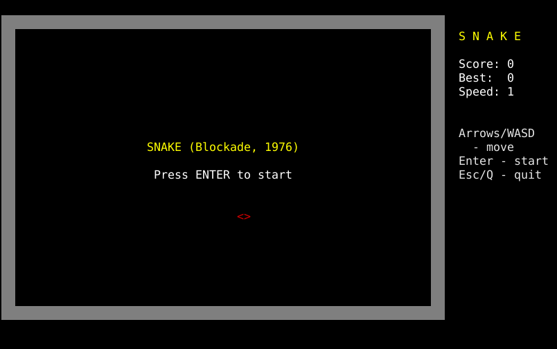
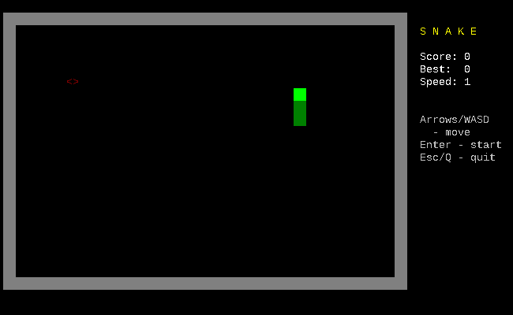
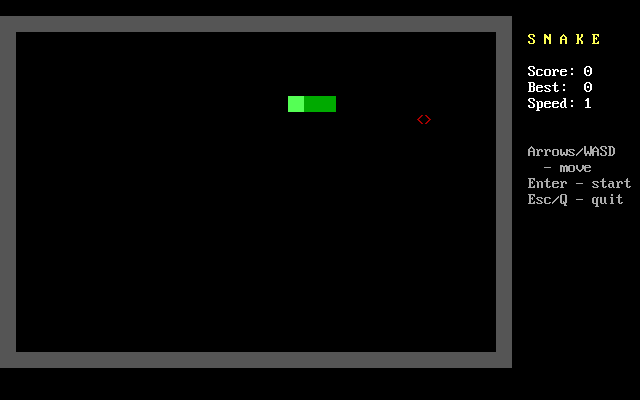
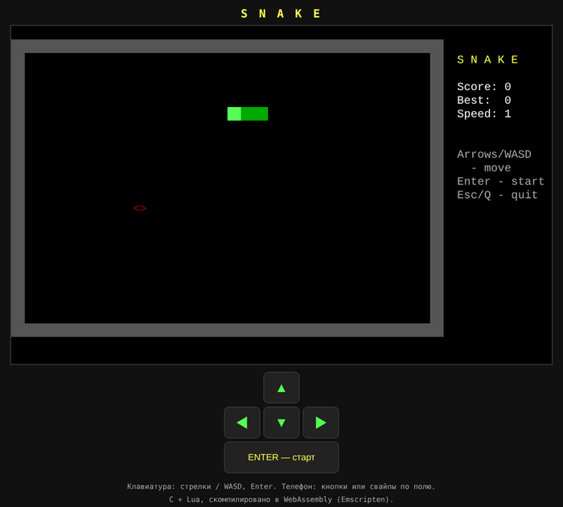

# Змейка — кроссплатформенная ретро-игра

[](https://github.com/GGradik/snake-xplat/actions/workflows/ci.yml)

Семестровый проект по дисциплине «Разработка кроссплатформенных
программных систем» (РТУ МИРЭА, кафедра КИС).

Классическая «Змейка» (прообраз — аркада *Blockade*, Gremlin, 1976).
Одна и та же программа работает в терминале Linux, в консоли Windows,
в MS-DOS и в браузере.

| Linux (терминал) | Windows (консоль) |
|---|---|
|  |  |
| **MS-DOS (DOSBox)** | **Браузер (WebAssembly)** |
|  |  |

## Платформы

| ОС (категория) | Процессор | Разрядность, порядок байт | Графика | Ввод | Компилятор |
|---|---|---|---|---|---|
| Linux (Unix) | x86-64 | 64 бита, little-endian | терминал (ANSI) | клавиатура | GCC |
| Windows | x86-64 | 64 бита, little-endian | консоль WinAPI | клавиатура | MinGW-w64 |
| MS-DOS (ретро) | i386 | 32 бита, little-endian | текстовый режим 80x25 | клавиатура (BIOS) | DJGPP |
| Web | wasm32 | 32 бита, little-endian | canvas | клавиатура, touch | Emscripten |
| Linux (только тесты) | MIPS | 32 бита, **big-endian** | — | — | GCC + qemu |

Итого: 4 категории ОС, 4 разных процессора, разная разрядность (64/32)
и порядок байт (little/big-endian).

## Архитектура

Программа разделена на три слоя:

```
 ┌──────────────────────────────────────────────┐
 │  game/snake.lua — ИГРОВАЯ ЛОГИКА (Lua)        │  одинакова везде
 │  init() / update(key) / draw()               │
 └───────────────▲──────────────────────────────┘
                 │ cls(), text(), fill()
 ┌───────────────┴──────────────────────────────┐
 │  src/engine.c — ЯДРО (C99)                   │  одинаково везде
 │  интерпретатор Lua, экранный буфер 80x25,    │
 │  очередь клавиш                              │
 │  src/main.c — главный цикл (20 тактов/с)     │
 └───────────────▲──────────────────────────────┘
                 │ platform.h: 6 функций
 ┌───────────────┴──────────────────────────────┐
 │  ПЛАТФОРМЕННЫЙ СЛОЙ (C) — свой для каждой ОС │
 │  plat_tty.c  plat_win.c  plat_dos.c          │
 │  plat_web.c                                  │
 └──────────────────────────────────────────────┘
```

**Игровая логика** написана на Lua (`game/snake.lua`) и ничего не знает
об ОС. Ядро вызывает три функции скрипта: `init()` при старте,
`update(key)` 20 раз в секунду и `draw()` после каждого `update`.
Скрипт рисует в экранный буфер функциями ядра:

| Функция | Что делает |
|---|---|
| `cls([bg])` | очистить экран |
| `text(x, y, str [, fg [, bg]])` | вывести строку |
| `fill(x, y, w, h [, fg [, bg [, ch]]])` | закрасить прямоугольник |

**Ядро** (`src/engine.c`) — интерпретатор Lua 5.4 и экранный буфер
80x25 символов с 16 цветами, как в текстовом режиме CGA/EGA/VGA.
Скрипт получает только безопасные библиотеки (нет `io`, `os`), поэтому
не может обращаться к файлам и ОС. Скрипт встраивается в исполняемый
файл при сборке утилитой `tools/bin2c.c`, и программе не нужны
дополнительные файлы.

**Платформенный слой** — шесть функций из `src/platform.h`:

```c
int  plat_init(void);                  /* подготовить экран и клавиатуру */
void plat_quit(void);                  /* вернуть всё как было */
int  plat_key(void);                   /* нажатая клавиша или KEY_NONE */
unsigned long plat_ticks(void);        /* время в миллисекундах */
void plat_sleep(int ms);               /* пауза */
void plat_present(const Screen *s);    /* вывести буфер 80x25 на экран */
```

Каждая реализация занимает 70–120 строк:

| Файл | Вывод | Ввод | Время |
|---|---|---|---|
| `plat_tty.c` | ANSI-последовательности | termios (сырой режим) | `clock_gettime` |
| `plat_win.c` | `WriteConsoleOutput` | `ReadConsoleInput` | `GetTickCount` |
| `plat_dos.c` | видеопамять B800h (`ScreenUpdate`) | BIOS (`getkey`) | `uclock` |
| `plat_web.c` | `<canvas>` (EM_JS) | keydown, кнопки, свайпы | `emscripten_get_now` |

Чтобы перенести игру на новую платформу, достаточно написать один такой
файл. Ядро и логику менять не нужно.

## Сборка

Нужны `make` и компилятор под нужную платформу:

```sh
make              # Linux: build/linux/snake        (нужен gcc или clang)
make windows      # build/windows/snake.exe         (x86_64-w64-mingw32-gcc)
make dos          # build/dos/SNAKE.EXE             (DJGPP, см. ниже)
make web          # build/web/index.html            (emcc)
make platforms    # всё сразу
```

Установка инструментов в Ubuntu 24.04:

```sh
sudo apt install build-essential gcc-mingw-w64-x86-64 emscripten \
                 gcc-mips-linux-gnu qemu-user wine dosbox
# DJGPP (кросс-компилятор под DOS):
curl -L https://github.com/andrewwutw/build-djgpp/releases/download/v3.4/djgpp-linux64-gcc1220.tar.bz2 \
  | sudo tar xj -C /opt
```

Путь к DJGPP можно переопределить: `make dos DJGPP_CC=... DJGPP_EXE2COFF=...`.

## Запуск

| Платформа | Как запустить |
|---|---|
| Linux | `./build/linux/snake` (терминал не меньше 80x25) |
| Windows | `build\windows\snake.exe` в консоли (cmd, PowerShell, Windows Terminal) |
| DOS | `SNAKE.EXE` в DOSBox или в настоящей DOS (нужен процессор 386+). DPMI-сервер уже встроен |
| Web | `cd build/web && python3 -m http.server`, затем открыть http://localhost:8000 |

Управление: стрелки или WASD — поворот, Enter или пробел — старт,
Esc или Q — выход. В браузере на телефоне работают экранные кнопки
и свайпы.

## Тестирование

```sh
make test          # на текущей машине (x86-64)
make test-mips     # на MIPS big-endian через эмулятор qemu
make test-windows  # Windows-сборка тестов через Wine
make check         # все три
```

Тесты не используют платформенный слой: они создают ядро, загружают
`snake.lua` и подают нажатия напрямую. Поэтому один и тот же набор
тестов собирается и запускается на любой платформе.

1. **Модульные тесты ядра** (`tests/test_core.c`): экранный буфер
   и обрезка по краям, очередь клавиш и её переполнение, сообщения
   об ошибках в скрипте, песочница (у скрипта нет `io`/`os`).
2. **Модульные тесты логики** (`tests/test_logic.c`): движение,
   скорость, повороты, запрет разворота, рост, ускорение, столкновения
   со стеной и с собой, победа при заполнении поля, рекорд.
3. **Интеграционные тесты** (`tests/test_integration.c`): бот
   (`tests/bot.lua`) играет полную партию от заставки до «GAME OVER»
   через очередь клавиш. Контрольная сумма финального кадра сравнивается
   с эталоном. Эталон одинаков на x86-64, MIPS big-endian и Windows,
   то есть логика детерминирована и не зависит от процессора.
4. **Тестирование свойств** (property-based testing,
   `tests/test_props.c`): 200 случайных партий по 1200 тактов. После
   каждого такта проверяются инварианты из `tests/invariants.lua`:
   - длина змейки = 3 + число съеденной еды;
   - змейка внутри поля, не пересекает себя и не «рвётся»;
   - еда есть, лежит в поле и не на змейке;
   - скорость соответствует счёту, рекорд не уменьшается;
   - за такт голова сдвигается не больше чем на 1 клетку.

   Если инвариант нарушен, контрпример **автоматически уменьшается**
   (shrinking): из него убираются нажатия, без которых ошибка всё равно
   воспроизводится. Печатается короткий пример вида
   `seed=1, 152 тактов, нажатия: 131:enter`. Отдельный тест проверяет
   сам механизм на заведомо ложном свойстве.

## Структура проекта

```
game/snake.lua          игровая логика
src/engine.[ch]         ядро: Lua + экранный буфер + клавиши
src/main.c              главный цикл
src/platform.h          интерфейс платформенного слоя
src/plat_*.c            реализации для Linux, Windows, DOS, Web
web/shell.html          HTML-страница для Web-версии
tools/bin2c.c           встраивание Lua-скрипта в программу
tests/                  автотесты
third_party/lua/        Lua 5.4.7 (MIT)
third_party/cwsdpmi/    DPMI-сервер для DOS
docs/                   скриншоты
.github/workflows/      CI: сборка всех платформ и тесты
```

## Сторонние компоненты

- [Lua 5.4.7](https://www.lua.org): лицензия MIT, см. `third_party/lua`.
- [CWSDPMI r7](http://sandmann.dyndns.info/cwsdpmi/): условия
  в `third_party/cwsdpmi/cwsdpmi.doc`.
